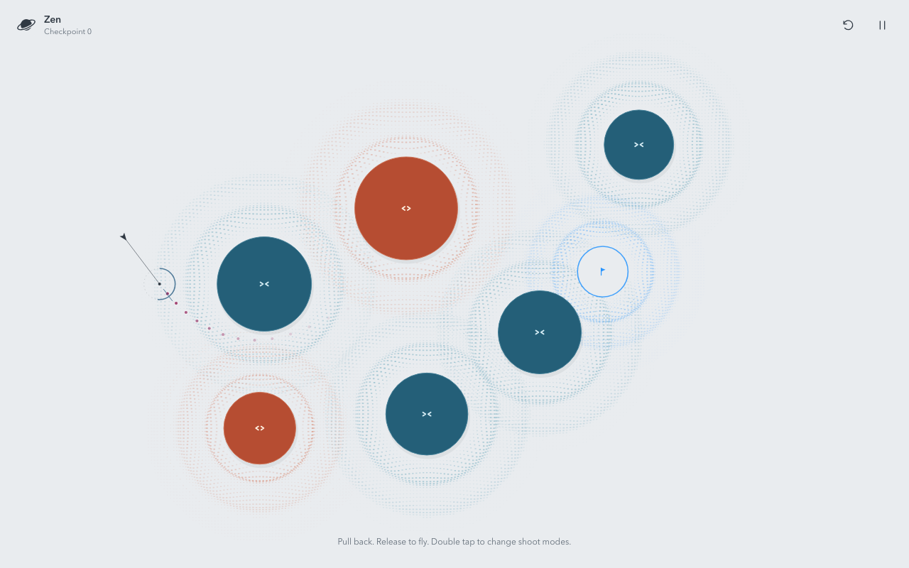

<p align="center">
  
</p>

<h1 align="center">Orbit</h1>

<p align="center">A little space to play.</p>

Pull back, release, and let gravity take over. Orbit is a quiet browser game about finding a path, building living orbits, and making little worlds of your own. No lives, high scores, or time pressure. Just one more launch.


## Three ways to play

**Zen** · Curve past attractors and repellers to reach the blue checkpoint ring. Each checkpoint opens a new field. Missed shots give you another try, with your checkpoint progress intact.

**Gravity** · Keep colourful projectiles orbiting to satisfy each field's challenge. Complete a revolution, gather several planets around a core, orbit in opposite directions, or circle two bodies together. Play 45 authored levels, then continue into endless procedural skies. Skip a level whenever you like, or use **Choose a level** in the pause menu to revisit unlocked fields.

**Creator** · Arrange bodies, shape their gravity, and play your own design. Choose an orbital challenge or leave **No challenge** selected for free play without an orbit counter.

## Pull, release, experiment

1. Click or touch the field and pull back to aim.
2. Pull farther for more speed.
3. Release to launch in the opposite direction.

Attractors pull you closer. Repellers push you away. Give solid bodies room as you pass, and watch your trail trace the journey.

In **Zen**, the shot launches from your ship's ring. Double-click or double-tap to switch between single and split mode. Select Split, launch, then tap during flight to branch into three ships.



In **Gravity**, start a pull anywhere to launch from that spot. Launch again while earlier planets are still flying to build several orbits at once. The **Size** slider affects newly launched planets; larger planets pull others more strongly. New planets are sized for the level's default view; manual zoom scales them with the scene, while resizing preserves existing planets' sizes and adapts the next launch. Particle interaction is on by default and can be switched off under **Pause → Advanced → Particle Interaction**.


## Settle into your own pace

- Pinch on touchscreens or scroll with a mouse to zoom the field. Gravity supports 50% to 400% zoom; a planet leaves play once its whole disc passes beyond the outermost view, regardless of the current zoom.
- Pause with the pause button, **Esc**, or **P**. Resume with the same keys, **Resume**, or a click outside the pause panel.
- Press **R** or use the reset button to retry the current Zen shot or reset the current Gravity level. In Zen, **New seed** starts a fresh checkpoint journey.
- Open **Pause → Advanced → Path assist** to switch between the default partial aiming preview and a full predicted path.
- Both game modes share a warm ambient melody with soft keys and occasional quiet chimes, with sound on by default. The sound toggle is remembered in this browser and shared across modes. Toggle sound in the pause menu, where you can also find **How to play**. Interactive guides appear on your first visit to each game mode.

Zen checkpoints and Gravity level progress save in this browser for each seed. Returning to a run resumes its saved checkpoint or level, rather than an in-flight shot. Add `?seed=42` to the URL for a repeatable starting world. Browser storage does not sync across devices and can be lost if you clear site data.

## Build your own sky

- Choose **Attractor** or **Repeller**, then tap an empty spot to add one.
- Drag bodies and the launcher into place. Nearby objects snap into alignment.
- Select a body and drag **Size** or **Gravity** to adjust them independently.
- Tap its type in the selection bar to switch between attraction and repulsion. Duplicate or delete it from the same bar.
- Pick a challenge, or keep **No challenge** for open-ended play. Adjust interactions, collisions, and trail length under **Physics**.
- Planets transfer momentum on contact without rebounding by default, then slide or separate as forces carry them. Mutual gravity can gather them into a cluster while every planet keeps its size and color. Settled groups pick up a gentle rotation, while fast rotation can still carry planets apart.
- Hit **Play** to experiment, then return to the editor to keep shaping your level.


Your draft saves automatically. Use **Save** to keep a level in your browser library, and **Levels** to return to it later. Creator saves use the same browser-local storage as progress.

## Run your own copy

With Node.js and npm installed:

```sh
npm ci
npm run dev
```

Open [localhost:5173](http://localhost:5173). No account, backend, or API keys are needed. Mouse and touch are supported, including portrait and landscape layouts.

```sh
npm test             # Unit and component tests
npm run build        # TypeScript checks and production build
npm run test:e2e     # Browser tests against the running server on port 5173
npm run preview     # Preview the production build locally
```

Browser tests need Chromium installed through `npx playwright install chromium`. The production build is written to `dist` for static hosting.

The included container builds the app and serves it with nginx on port 80. Use its explicit filename:

```sh
docker build -f Dockerfile.vercel -t orbit .
docker run --rm --name orbit -p 8080:80 orbit
```

Open [localhost:8080](http://localhost:8080). To deploy the included `Dockerfile.vercel` on Vercel, see the [official Docker guide](https://vercel.com/kb/guide/docker) and the [development guide](docs/development.md).
