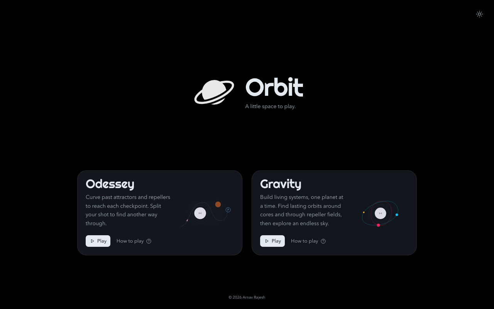
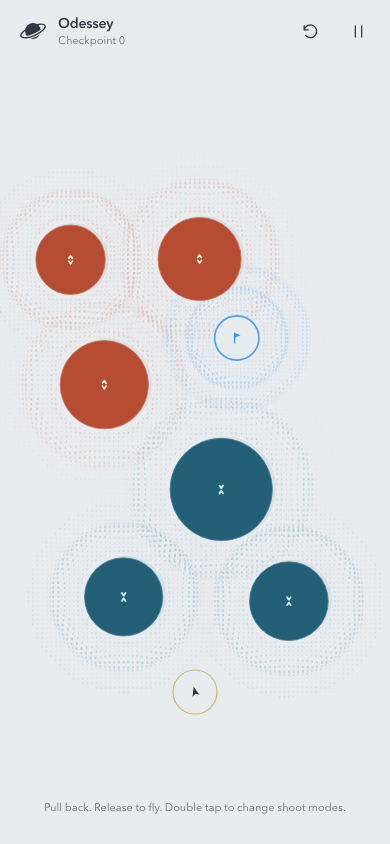
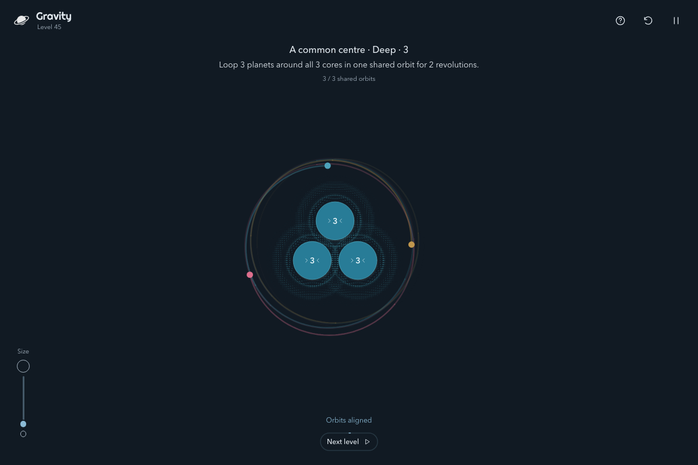
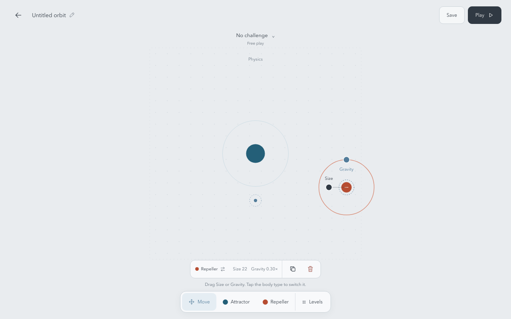

<p align="center">
  
</p>

<h1 align="center">Orbit</h1>

<p align="center">A little space to play.</p>

Pull back, release, and let gravity take over. Orbit is a quiet browser game about finding a path, building living orbits, and making little worlds of your own. No lives, high scores, or time pressure. Just one more launch.



## Three ways to play

**Odessey** · Curve past attractors and repellers to reach the blue checkpoint ring. Each checkpoint opens a new field. Missed shots give you another try, with your checkpoint progress intact.

**Gravity** · Build lasting local and shared orbits, one planet at a time. Tap or click clear space to place a planet and let gravity move it, or pull back to give it a launch speed and direction. The pull can extend freely; short pulls stay precise and longer pulls gradually approach a safe maximum speed. Play 45 challenges across nine distinct layouts, followed by seeded endless variants. Every campaign challenge requires at least two complete revolutions. Different fields combine attractive cores and repellers; later variations require more orbiters or change the field itself. Core counters show established orbiters without letter labels or target fractions. Use **Skip level** at the bottom and confirm to move on, or **Choose a level** in Pause to revisit unlocked fields. Once earned, a win stays earned. A three-second border countdown around **Next level** advances automatically; tap to advance sooner, or pause to stop the countdown.

**Creator** · Arrange bodies, shape their gravity, and play your own design. Choose an orbital challenge or leave **No challenge** selected for free play without an orbit counter.

## Pull, release, experiment

1. Click or touch the field and pull back to aim.
2. Pull farther for more speed.
3. Release to launch in the opposite direction.

Attractors pull you closer. Repellers push you away. Give solid bodies room as you pass, and watch your trail trace the journey.

In **Odessey**, the shot launches from your ship's ring. Portrait levels run from bottom to top; wider views run from left to right. The starting camera fits the playable objects as closely as possible with edge padding and room to pull. Double-click or double-tap to switch between single and split mode. Select Split, launch, then tap during flight to branch into three ships.



In **Gravity**, start a pull anywhere to launch from that spot. Launch again while earlier planets are still flying to build several orbits at once. The **Size** slider affects newly launched planets; larger planets pull others more strongly. New planets are sized for the level's default view; manual zoom scales them with the scene, while resizing preserves existing planets' sizes and adapts the next launch. Particle interaction is on by default and can be switched off under **Pause → Advanced → Particle Interaction**. **Particle grouping** is a separate, saved setting and is off by default: planets pass through each other while still attracting when interaction is on. Enable grouping for momentum-dependent encounters: slow bound planets can settle on separate surfaces, while fast or glancing encounters transfer momentum and can continue apart. Fast encounters use a soft passage model rather than rigid bouncing or destructive merging. Each Advanced toggle has a **?** button explaining it.



## Settle into your own pace

- Orbit starts in AMOLED-friendly dark mode with a pure-black background. Use the sun/moon control on the home page or **Dark mode** in Pause to switch themes. Your choice is saved in this browser and shared across both games and the creator.

- Pinch on touchscreens or scroll with a mouse to zoom the field around your fingers or cursor. Odessey supports roughly 83% to 120% zoom and Gravity supports 50% to 200%. In either gameplay mode, drag with two fingers, hold Space and drag, or drag with the middle mouse button to pan without launching. The camera follows flights within the level; manual panning takes over until the next shot. An offscreen Odessey ship gets five seconds to return, with a Restart control available immediately. Bringing it back into view resets the timer. Gravity removes a planet only on contact with a fixed obstacle or once its whole disc leaves the outermost view.
- Click the Orbit logo at the top left in either game mode to return to the main menu. Your checkpoint or level progress stays saved.
- Pause with the pause button, **Esc**, or **P**. Resume with the same keys, **Resume**, or a click outside the pause panel.
- Use the **?** icon before Reset in the top bar to open How to play.
- Press **R**, use the reset button, or choose **Restart level** in Pause to retry the current Odessey checkpoint or reset the current Gravity level. In Odessey, **New seed** starts a fresh checkpoint journey.
- Open **Pause → Advanced → Path assist** to switch between the default partial aiming preview and a full predicted path. Gravity’s partial hint spans up to 600 screen pixels. Full assist predicts up to 60 physical seconds, updating smoothly against moving planets. The near path refreshes first while the longer horizon calculates within a frame budget. Holding a Gravity shot gently slows playback; release or cancel restores normal pace.
- Supported mobile browsers give a short vibration when a deliberate aim begins and a successful shot launches. Devices without the Vibration API, including iOS browsers, continue without vibration.
- Both game modes share a warm ambient melody with soft keys and occasional quiet chimes, with sound on by default. The sound toggle is remembered in this browser and shared across modes. Toggle sound in the pause menu, where you can also find **How to play**. Interactive guides appear on your first visit to each game mode.

Odessey checkpoints and Gravity level progress save in this browser for each seed. Returning to a run resumes its saved checkpoint or level, rather than an in-flight shot. Add `?seed=42` to the URL for a repeatable starting world. Existing Zen links and browser saves continue to work and migrate to Odessey automatically. Browser storage does not sync across devices and can be lost if you clear site data.

The [campaign guide](docs/gravity-campaign-api.md) explains the verified sequential solutions and the explicit difficulty ceilings for endless play. With the dev server running, open [the campaign replay page](http://localhost:5173/docs/verification/campaign-replay.html) to watch any of the 45 recorded solutions launch one planet at a time. The [independent sequential audit](docs/verification/independent-sequential-report.md) and [critical pacing review](docs/verification/campaign-gamer-review.md) document the final checks and their limits.

## Build your own sky

- Choose **Attractor** or **Repeller**, then tap an empty spot to add one.
- Drag bodies and the launcher into place. Nearby objects snap into alignment.
- Select a body and drag **Size** or **Gravity** to adjust them independently.
- Tap its type in the selection bar to switch between attraction and repulsion. Duplicate or delete it from the same bar.
- Pick a challenge, or keep **No challenge** for open-ended play. Adjust interactions, collisions, and trail length under **Physics**.
- Planets transfer momentum on contact without rebounding by default, then slide or separate as forces carry them. Mutual gravity can gather them into a cluster while every planet keeps its size and color. Settled groups pick up a gentle rotation, while fast rotation can still carry planets apart.
- Hit **Play** to experiment, then return to the editor to keep shaping your level.



Your draft saves automatically. Use **Save** to keep a level in your browser library, and **Levels** to return to it later. Creator saves use the same browser-local storage as progress.

## Run your own copy

With Node.js and npm installed:

```sh
npm ci
npm run dev
```

Open [localhost:5173](http://localhost:5173). No account, backend, or API keys are needed. Mouse and touch are supported, including portrait and landscape layouts.

```sh
npm test             # Unit and component tests
npm run build        # TypeScript checks and production build
npm run test:e2e     # Browser tests against the running server on port 5173
npm run preview     # Preview the production build locally
```

Browser tests need Chromium installed through `npx playwright install chromium`. The production build is written to `dist` for static hosting.

The included container builds the app and serves it with nginx on port 80. Use its explicit filename:

```sh
docker build -f Dockerfile.vercel -t orbit .
docker run --rm --name orbit -p 8080:80 orbit
```

Open [localhost:8080](http://localhost:8080). To deploy the included `Dockerfile.vercel` on Vercel, see the [official Docker guide](https://vercel.com/kb/guide/docker) and the [development guide](docs/development.md).
